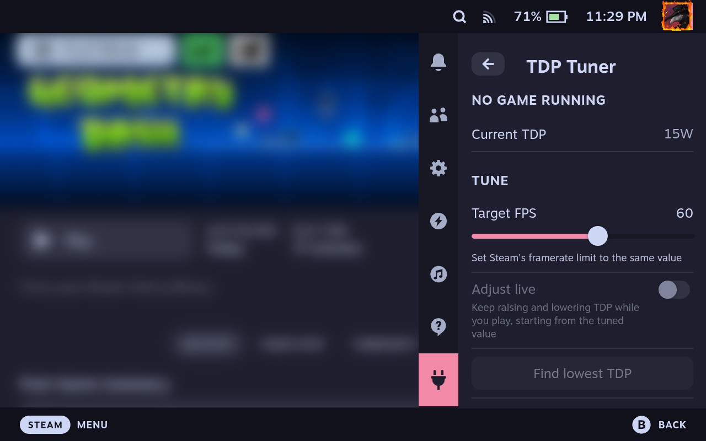
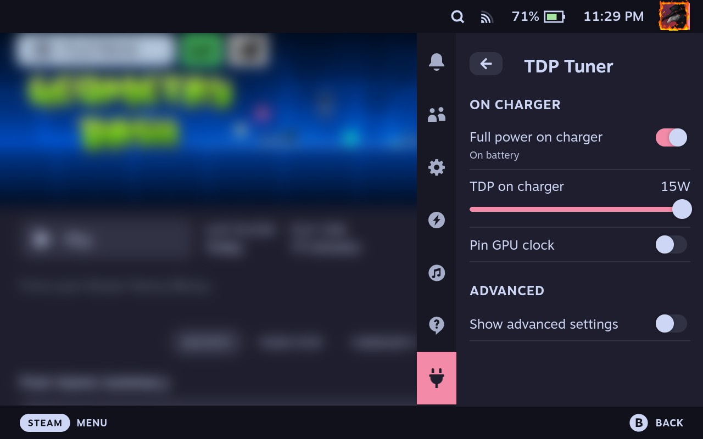

# DeckyTDPTuner

<p align="center">
  
  
</p>

## Overview
>[!WARNING]
> This plugin runs as **root** and writes straight to the amdgpu power limits in sysfs (`power1_cap` and `power2_cap`). It never goes outside the range the driver reports, but if something goes wrong a reboot puts everything back to stock.

Pick a target framerate in the Quick Access Menu, press "Find lowest TDP" and leave the game running somewhere that's roughly as heavy as the rest of it (a busy town, not a loading screen). The plugin starts at 15W, checks that the game can actually hold the target there, and then binary searches down until it finds the lowest wattage that still keeps the average and the 5% lows above the target. Each step settles for 5 seconds and samples for 10. The lowest passing wattage isn't always the nicest one though (Geometry Dash holds 90 fps at 4W but the frametime graph turns into a sawtooth, at 5W it's flat), so once it has a result it also measures frametime jitter and keeps going up 1W at a time for as long as the next watt is at least 25% smoother. A full run takes a minute or two, and the result gets saved for that game and applied automatically every time you launch it (or as soon as the plugin loads, if the game is already running).

If even 15W can't hold the target, the panel says so in big red letters along with the best framerate it actually got, nothing gets saved, and there's a button to drop the target to something that would have passed.

### Adjust live

Tuning once only knows about whatever was on screen during that minute, so if the game gets heavier later (bosses, big fights, etc) the saved value might not be enough. With **Adjust live** turned on, the tuned value becomes the starting point and the floor, and the plugin keeps watching frametimes for the whole session. It raises the TDP by 2W when the framerate stays under 93% of the target for a couple of seconds (4W if it's under 75%), but only lowers it 1W at a time after 15 seconds of steady frames with the GPU under 85% busy. If a drop causes a miss, or makes the frametimes noticeably more jagged than they were before it, it goes straight back up and that wattage becomes the floor for a while (it decays after 2 minutes without misses). Changing the power cap doesn't cause a hitch by itself since it's just a ceiling the SMU enforces, the only thing that can stutter is the cap being too low when the load spikes, which is what the fast raise is for. If it's sitting at 15W and still missing, the panel tells you that too.

### On charger

Once you're plugged in the battery doesn't really matter, so **Full power on charger** pushes the TDP up (15W by default) and pins the GPU clock (1600MHz by default) as long as the charger is connected, with or without a game running. Both can be changed in the panel and get saved, and pinning the GPU can be turned off if you only want the TDP. The GPU clock is limited by the charger TDP, you get the full clock from 10W up and less below that, because pinning 1600MHz at 4W just starves the CPU since they share the same power budget.

Unplugging puts back whatever the running game would normally get. Without live mode it ramps down 1W every half a second instead of dropping all at once, and with live mode on the governor starts from the charger wattage and works its way down on its own, so unplugging in a heavy area doesn't tank the framerate.

### Advanced

Hidden behind a toggle at the bottom of the panel. The only thing in there right now is **Lowest TDP**, which is how low tuning and live mode are ever allowed to go. It defaults to 4W because some games crash or hang outright below that (Geometry Dash does at 3W), but you can move it anywhere between what the driver allows and 10W. A lower power cap can't hurt the Deck itself, a hung game can still eat your unsaved progress though.

Things to keep in mind:
- Set Steam's **framerate limit** to the same value as the target. The whole point is that the game is capped and the APU is just burning power past what it needs, so without a limit it'll happily use all 15W to render frames you'll never see.
- Leave Steam's own **TDP limit** slider off, otherwise Steam and the plugin will keep overwriting each other.
- Frametimes come from mangoapp (the thing behind the performance overlay), the plugin turns on its CSV logging while tuning or in live mode and turns it off again afterwards. The overlay itself doesn't need to be visible.
- Live mode logs every 100ms for as long as the game runs. The CSV lives in `/tmp`, which is RAM on SteamOS, and grows by roughly 3MB an hour.
- Same as the TDP slider, Steam's own **manual GPU clock** setting and full power on charger will fight each other, and unplugging puts the GPU clock back on auto.
- It's only been written with the Steam Deck in mind (LCD and OLED), other handhelds running SteamOS *might* work if their amdgpu hwmon exposes `power1_cap`.
- I am not responsible for thermonuclear war, bricked devices, and bla-bla, you know the old saying ;)

## Building

You need `pnpm`, `go` (1.21 or newer) and `make`.

```sh
pnpm i
pnpm build

cd backend
make
```

Then `./scripts/package.sh` puts everything into `out/DeckyTDPTuner-<version>.zip` (it just copies what you built, so build first), or let the [decky CLI](https://github.com/SteamDeckHomebrew/cli) do the whole thing for you, it builds the backend inside the holo go toolchain image:

```sh
decky plugin build .
```

To install, enable developer mode in Decky's settings and use "Install Plugin From ZIP".

## Usage

The Go backend can also be poked at directly over ssh, which is handy for checking whether your device is supported at all (it just prints the hwmon it found and the allowed range):

```sh
sudo ./tdptuner -info
sudo ./tdptuner -set 8
```

Logs end up in `tdptuner.log` under the plugin's folder in `~/homebrew/logs/`. Under `~/homebrew/settings/` there's `profiles.json` with the tuned values per game and `settings.json` with the charger and advanced settings (`full_power`, `watts`, `gpu_clock`, `pin_gpu` and `min_watts`, where 0 means the default), and you can edit both by hand if you want to. The default for the lowest TDP comes from the backend's `-min` flag, which is 4 unless you change it.

## License

This project is licensed under the **GNU General Public License v3.0 (GPL-3.0)**.

Key points to be aware of:

* You are free to use, modify, and distribute the software.
* If you distribute it (or anything built from it), you have to make the source available under the same license.
* You must keep the copyright notice and the license text when redistributing.
* There is no warranty of any kind.

For full details, please refer to the [LICENSE](./LICENSE) file.

## Acknowledgments

### decky-plugin-template
The frontend build setup (`rollup.config.js`, `tsconfig.json` and most of `package.json`) comes from [`decky-plugin-template`](https://github.com/SteamDeckHomebrew/decky-plugin-template).

`decky-plugin-template` is licensed under the [BSD 3-Clause License](https://opensource.org/licenses/BSD-3-Clause).

> © Steam Deck Homebrew and contributors.

> <small>_Original source: https://github.com/SteamDeckHomebrew/decky-plugin-template_</small>

### MangoHud
Not bundled, but nothing here works without it. All the frametime data comes from [`MangoHud`](https://github.com/flightlessmango/MangoHud)'s logging, which SteamOS ships as mangoapp.

> <small>_Original source: https://github.com/flightlessmango/MangoHud_</small>

## Disclaimer

This software is provided **"as is"** without any warranty of any kind, express or implied. By using this plugin, you acknowledge that:

* Lowering the TDP can make games stutter or perform worse than you expect, the plugin only measures what happens while it's watching.
* Going under the default lowest TDP can make some games crash or hang.
* You are solely responsible for any consequences resulting from the use, misuse, or inability to use this software.
* The maintainers and contributors of this project are **not liable for any damage**, data loss or device malfunction that may arise.
